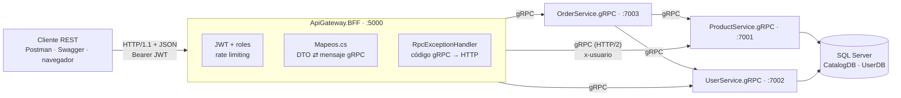

# ECommerceGRPC · Tarea 1 · Arquitectura híbrida REST/gRPC con JWT

Microservicios Resilientes (Nivel 2). El gateway **ApiGateway.BFF** expone REST con JSON hacia afuera y
llama por gRPC a los servicios de adentro. En esta tarea se le agregaron tres endpoints REST nuevos que
responden desde dos servicios gRPC que ya existían. No se cambió ningún `.proto` ni ningún servicio gRPC.

## Integrantes del grupo

Grupo 1

- Allan Arce
- Roger Benavides
- Fabio Ávila Pérez
- Rigoberto Arroyo Alvarado

## Arquitectura



Versión en texto:

```
Cliente REST ──HTTP/JSON + JWT──► ApiGateway.BFF :5000 ──gRPC──► ProductService.gRPC :7001 ──► CatalogDB
                                   (auth, rate limit,   ──gRPC──► UserService.gRPC    :7002 ──► UserDB
                                    Mapeos, errores)    ──gRPC──► OrderService.gRPC   :7003 ──► (Usuarios y Productos por gRPC)
```

## Cómo levantar el sistema

Requisitos: Docker Desktop encendido. Si tiene otro kit del curso levantado, apáguelo primero porque usan los mismos puertos.

```bash
cd Infrastructure
docker compose up -d --build
docker compose ps
```

Levanta siete servicios: `sqlserver`, `catalog-service`, `user-service`, `product-grpc`, `user-grpc`, `order-grpc` y `gateway`.

| Qué | Dirección |
|---|---|
| Gateway REST + Swagger | http://localhost:5000/swagger |
| Productos gRPC | localhost:7001 |
| Usuarios gRPC | localhost:7002 |
| Pedidos gRPC | localhost:7003 |
| SQL Server | localhost,1434 |

Para probar todo, importe `Postman/ECommerceGRPC_Clase2.postman_collection.json` en Postman y use **Run collection**.
La carpeta **«6 · Tarea 1»** prueba los endpoints nuevos. Tiene una espera de 31 s antes de la cuarta escritura del Admin,
porque la política `escrituras` admite 3 por usuario cada 30 s.

## Usuarios de prueba

El token se pide con `POST /api/auth/login`.

| Correo | Clave | Rol | Id en UserDB |
|---|---|---|---|
| admin@example.com | Admin2026! | Admin | 1 |
| user@example.com | Cliente2026! | Cliente | 2 |

```http
POST http://localhost:5000/api/auth/login
Content-Type: application/json

{ "email": "admin@example.com", "clave": "Admin2026!" }
```

## Endpoints nuevos

| # | Endpoint | Llama a (gRPC) | Quién puede | Rate limiting | Respuestas |
|---|---|---|---|---|---|
| 1 | `POST /api/v1/productos` | `ProductService.CreateProduct` | Rol Admin | `escrituras`: 3 cada 30 s por usuario | 201 · 400 · 401 · 403 · 409 · 429 |
| 2 | `POST /api/v1/usuarios/registro` | `UserService.CreateUser` | Cualquiera, sin token | `registro`: 5 por minuto por IP | 201 · 400 · 409 · 429 |
| 3 | `GET /api/v1/usuarios` | `UserService.ListUsers` (server streaming) | Rol Admin | `lecturas`: 10 cada 10 s por IP | 200 · 401 · 403 · 429 |

Los errores gRPC se traducen a HTTP en un solo lugar (`Errores/RpcExceptionHandler.cs`): `InvalidArgument` → 400,
`AlreadyExists` → 409, `NotFound` → 404, `Unavailable` → 503. Si se supera el límite, responde 429 con el encabezado `Retry-After`.

### 1 · Crear producto (Admin)

```http
POST http://localhost:5000/api/v1/productos
Authorization: Bearer <token de Admin>
Content-Type: application/json

{
  "nombre": "Soporte para monitor",
  "descripcion": "Brazo articulado de aluminio",
  "precio": 49.90,
  "stock": 10,
  "categoria": "Accesorios"
}
```

```http
HTTP/1.1 201 Created
Location: http://localhost:5000/api/v1/productos/4

{ "id": 4, "nombre": "Soporte para monitor", "descripcion": "Brazo articulado de aluminio",
  "precio": 49.9, "categoria": "Accesorios", "stock": 10, "disponible": true }
```

Errores:
- **400**: el precio no es mayor que 0, o falta el nombre o la categoría.
- **401**: sin token.
- **403**: token de Cliente.
- **409**: ya existe un producto con ese nombre.

```json
{ "title": "La solicitud no se pudo completar.", "status": 409,
  "detail": "Ya existe un producto llamado 'Soporte para monitor'.", "codigoGrpc": "AlreadyExists" }
```

### 2 · Registro de usuario (sin token)

```http
POST http://localhost:5000/api/v1/usuarios/registro
Content-Type: application/json

{ "email": "ana.ruiz@example.com", "nombre": "Ana", "apellido": "Ruiz", "clave": "Segura2026!" }
```

```http
HTTP/1.1 201 Created
Location: http://localhost:5000/api/v1/usuarios/3

{ "id": 3, "email": "ana.ruiz@example.com", "nombreCompleto": "Ana Ruiz",
  "activo": true, "creadoEl": "2026-11-15T16:11:47.3005802Z" }
```

Errores:
- **400**: falta un campo, o la clave tiene menos de 8 caracteres.
- **409**: el correo ya está registrado.

La clave nunca vuelve en la respuesta, y UserService guarda solo su hash BCrypt.

### 3 · Listar usuarios (Admin)

```http
GET http://localhost:5000/api/v1/usuarios
Authorization: Bearer <token de Admin>
```

```http
HTTP/1.1 200 OK

[
  { "id": 1, "email": "admin@example.com", "nombreCompleto": "Admin System", "activo": true, "creadoEl": "2026-09-14T00:00:00Z" },
  { "id": 2, "email": "user@example.com",  "nombreCompleto": "John Doe",     "activo": true, "creadoEl": "2026-09-14T00:00:00Z" }
]
```

`ListUsers` es server streaming: el gateway lee un mensaje por usuario activo y los junta en una lista JSON.
Errores:
- **401**: sin token.
- **403**: token de Cliente.

## Resiliencia: un servicio caído

```bash
cd Infrastructure
docker compose stop order-grpc
```

`POST /api/v1/pedidos/validar` responde **503** sin que el gateway se caiga:

```json
{ "title": "Un servicio interno no responde.", "status": 503,
  "detail": "Error connecting to subchannel.", "codigoGrpc": "Unavailable" }
```

Mientras tanto, los demás endpoints (`/api/v1/productos`, `/api/v1/usuarios`…) siguen respondiendo 200. Para volver a encenderlo:

```bash
docker compose start order-grpc
```

## Qué se cambió en el código

| Archivo | Cambio |
|---|---|
| `ApiGateway.BFF/Modelos/Dtos.cs` | `CrearProductoDto` (precio `decimal`) y `RegistroDto` (Email, Nombre, Apellido, Clave) |
| `ApiGateway.BFF/Modelos/Mapeos.cs` | `ACreateProduct` (`decimal` → `double`) y `ACreateUser`: DTO → mensaje gRPC |
| `ApiGateway.BFF/Controllers/ProductosController.cs` | `POST /api/v1/productos` con `CreatedAtAction` hacia el GET por id |
| `ApiGateway.BFF/Controllers/UsuariosController.cs` | `POST /api/v1/usuarios/registro` y `GET /api/v1/usuarios` |
| `ApiGateway.BFF/Program.cs` | Política de rate limiting `registro` (por IP, para el endpoint sin token) |
| `Postman/ECommerceGRPC_Clase2.postman_collection.json` | Carpeta «6 · Tarea 1» con un `pm.test` por cada respuesta |
